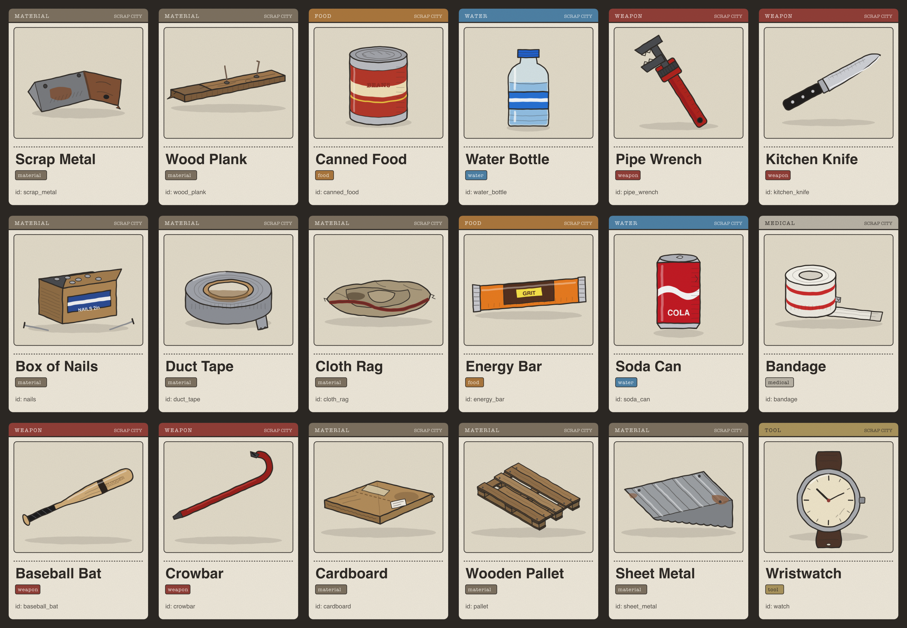

I make Roblox games with my friend Trip under [Plymouth Experiences](https://www.roblox.com/communities/7205703), a small studio in Chicago.

## Be a Stone

[Published on Roblox](https://www.roblox.com/games/92465829726635) in September 2026. An incremental simulator: roll a stone until it is perfectly smooth, sell it for gems, and rebirth into the next of 20 rocks.

- **Thirteen worlds**, from Skylines and Sunstone Dunes to Neon Speedway, Floor Is Lava and Clockwork Rush. Each one is generated by a build script kept in git, so a world can be rebuilt or rolled back.
- **Ghost races.** The server records your stone five times a second on every level run, keeps your fastest finish, and replays it as a see-through ghost next time. Positions come only from the server's own checks, so a ghost can't be faked.
- **Infinite Roll.** An endless sky road generated around each player as they roll.
- **Prestige, races, an arena, a Hall of Fame and codes.** Codes live on the server only, so unreleased codes can't be read out of the client.
- **Quarry Club.** A paid membership with a daily chest, bonus gems and XP, and a members-only skin.

About 50,000 lines of Luau across 162 scripts, with 30 server services and boot-time self-checks.

## Scrap City

In development with Trip. Open-world urban survival: spawn with nothing, search dumpsters and trash piles for food, water, weapons and materials, build a base from what you find, then team up with other players or fight them for it. Every item has a card drawn from its in-game 3D model; the city, its neighborhoods, a rail line and police are planned across 26 design documents.

## How we build

- **A shared engine.** Every game uses one Luau engine: boot, networking, saved player data with ProfileStore, input validation, and a probe for automated tests.
- **Two agents, one repo.** Trip and I each work with our own Claude Code agent. The agents coordinate through the repo: messages, advisory file locks, and decision records.
- **A playtest squad.** Five agents play every build in Studio the way real players would: an explorer, a first-timer, a grinder, a mobile player and an exploiter. An economy analyst and a Luau reviewer check the rest.
- **Tooling.** Strict Luau, Rojo and Wally, linted with Selene and formatted with StyLua.
