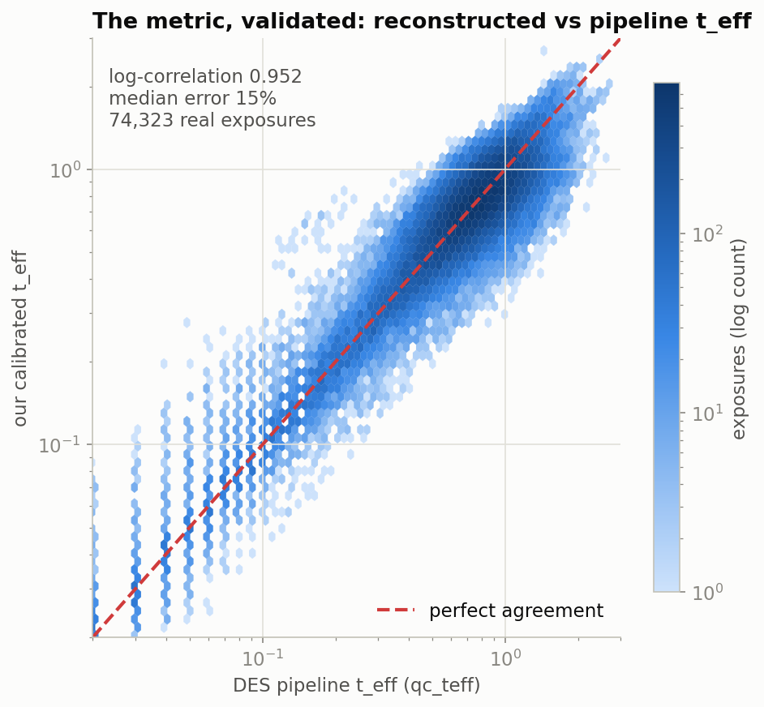
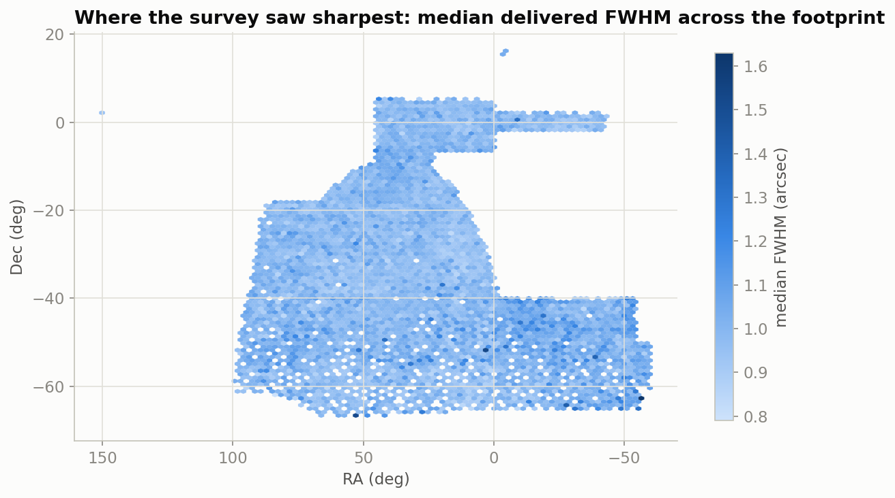
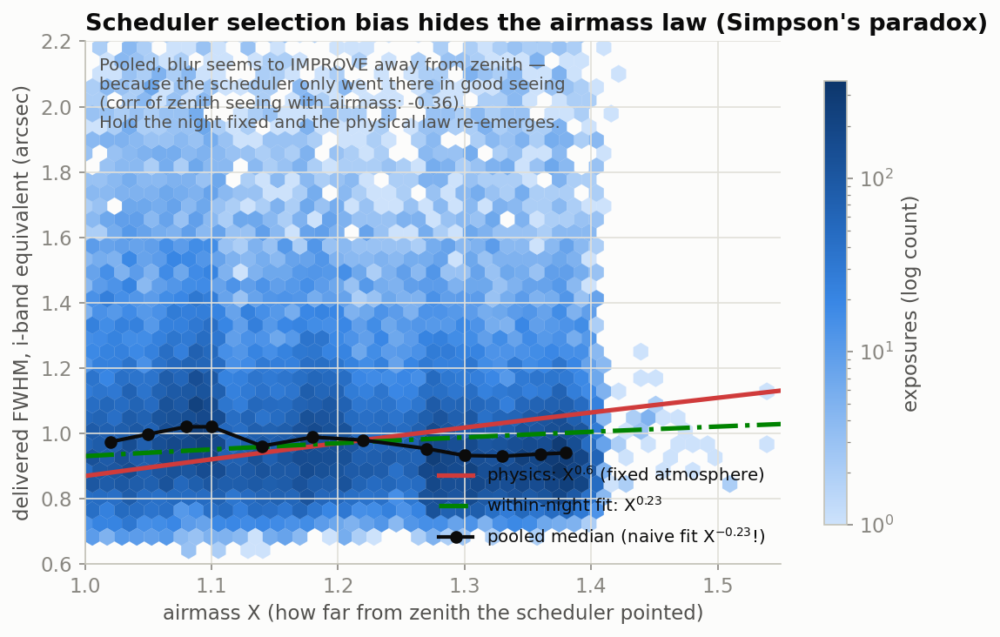
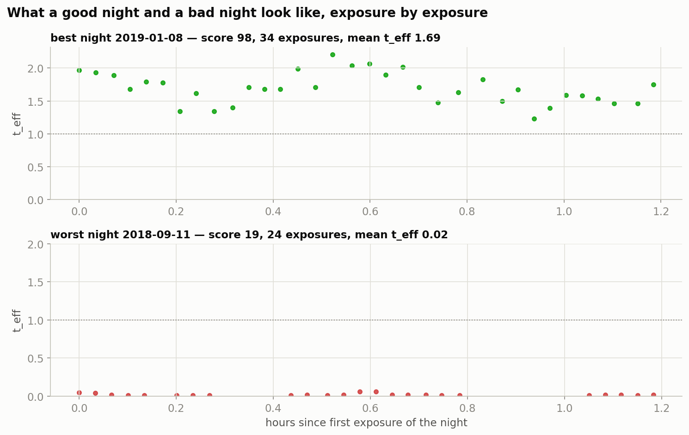

I spent summer 2026 as a researcher at the NSF-Simons AI Institute for the Sky (SkAI) in Chicago, advised by Prof. Alex Drlica-Wagner. I designed, built and validated the work myself. The project: give an AI telescope scheduler a single number for how good a night of observing was, then test that number against six observing seasons of real survey data.

- [The poster (PDF)](/skai/poster.pdf)
- [The full report, every figure and table](/skai/report/)
- [Interactive dashboard](/skai/dashboard/)
- [Working note, v0.1 (PDF)](/skai/working-note-v0.1.pdf): the method, the calibration and the validation tests in full

## The question

A scheduler picks what to point at next. To train or judge one you need a reward. Clock time is not enough: 90 seconds through bad seeing, thin cloud or a bright sky is worth less science than the same 90 seconds on a perfect night.

## The metric

Each exposure is discounted by its conditions. Effective exposure time weighs transparency, image sharpness and sky brightness, each against a fiducial value:

```
t_eff = η² · (FWHM_fid / FWHM)² · (b_dark / b)
```

A night's score is how much of its time became effective science seconds, combined with how evenly it filled the sky and how little time went to slews and overhead.



## What held up

| Check | Result |
| --- | --- |
| My `t_eff` against the DES pipeline's `qc_teff`, 74,323 exposures | log-correlation 0.952, median error 15% (the published constants: 24%) |
| Fitted fiducial seeing across the five filters | follows the atmospheric λ^-0.2 law |
| Composite score on 615 real nights, under reweighting | ranking stable for most weight sets (Spearman ≥ 0.98) |



## A finding: Simpson's paradox in scheduler logs

Pooled across the survey, seeing appears to *improve* as the telescope points lower, which is physically backwards. The cause is selection: the scheduler preferentially chose low pointings when conditions were already good. Split by night, the expected relationship comes back. Any reward learned from raw logs inherits that bias unless it controls for it.





## Data

The public DES exposure log: 105,889 exposures taken with DECam on the Víctor M. Blanco 4-metre telescope at Cerro Tololo, Chile, between August 2013 and January 2019. Calibration and scoring use the homogeneous core of the survey, 74,323 standard 90-second survey exposures after quality cuts, spread over 615 scoreable nights. The poster's image-quality panel counts 627 nights; it grades nights on image quality alone, before the composite's requirements. Analysis in Python with pandas and astropy, packaged as the `skai_metrics` toolkit with automated validation tests.
